# Pro Tools-style: gallery

Every shot of the daw-theme gallery (spec 1, golden session 1), rendered by `daw-view-tools gallery`. Generated: render it again rather than editing it.

## Classic (`protools-classic`)

| Shot | What it shows | Picture |
| --- | --- | --- |
| **Arrangement** `arrangement.overview` 1600×900 | The whole song: folders three deep, every clip colour, sections, markers, tempo and meter changes, the edit cursor, a time selection and the playhead. | [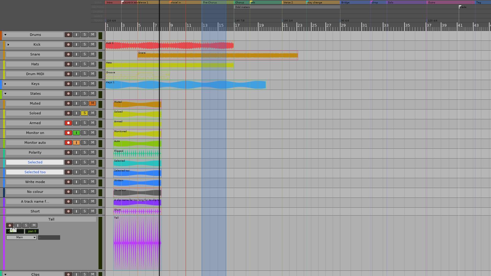](protools-classic/arrangement.overview.png) |
| **Track states** `arrangement.track-states` 1600×900 | One track per state: muted, soloed, solo-safe, armed, monitoring on and auto, polarity flipped, FX bypassed and missing, selected, several selected, a focused track, and a track with no colour. | [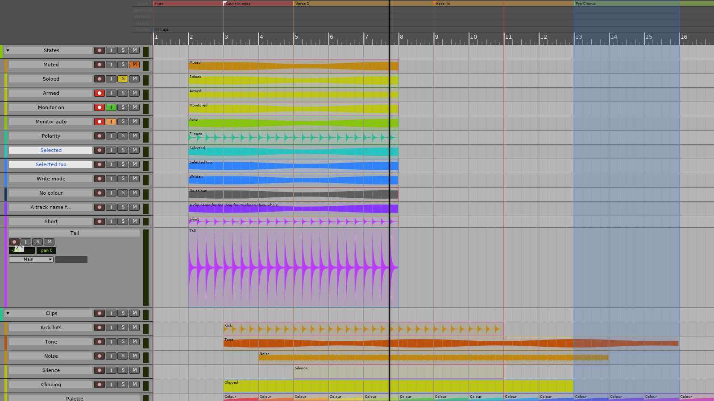](protools-classic/arrangement.track-states.png) |
| **Clips** `arrangement.clips` 1600×900 | Audio drawn from synthesized waveforms (a kick, a tone, noise, silence, a clipped bus) and MIDI notes; clips selected, muted, locked, faded, crossfaded, overlapping, on take lanes, and past both edges of the view. | [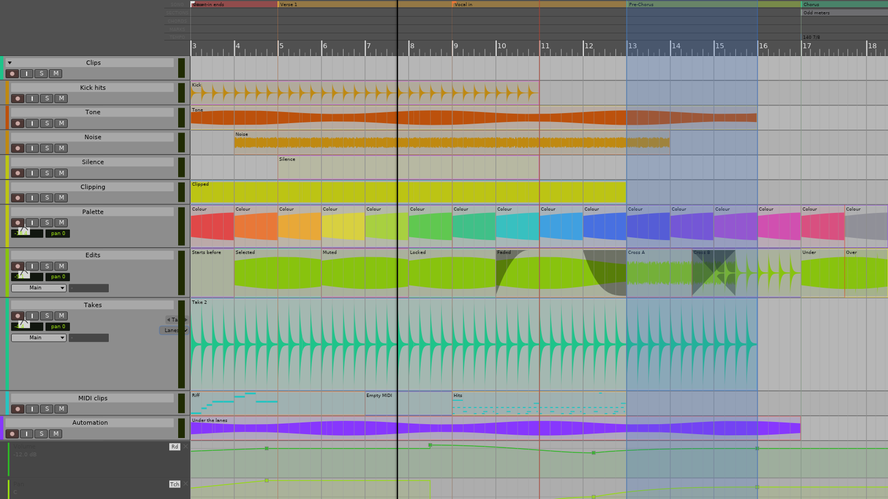](protools-classic/arrangement.clips.png) |
| **Ruler and tempo** `arrangement.ruler-tempo` 1600×900 | The ruler close up across the tempo and meter changes (4/4, 7/8, 3/4), the sections of every colour and the markers above them. | [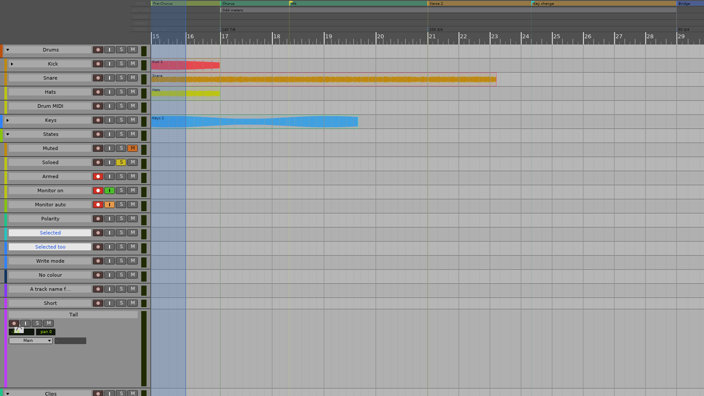](protools-classic/arrangement.ruler-tempo.png) |
| **Automation** `arrangement.automation` 1600×900 | Volume, pan, mute and a plugin parameter, each in its mode, with points of every shape. | [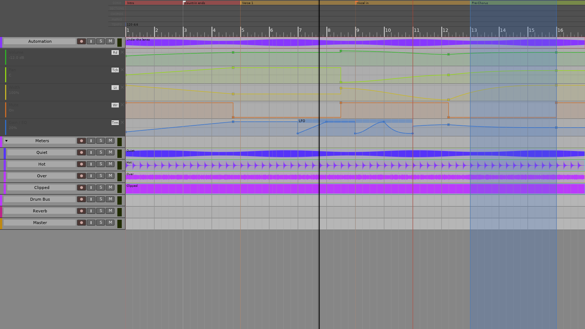](protools-classic/arrangement.automation.png) |
| **Track panel** `tcp.closeup` 900×600 | A few rows of the track panel tall enough to read every control: names, numbers, the folder buttons, the controls a row places, a long name cut short. | [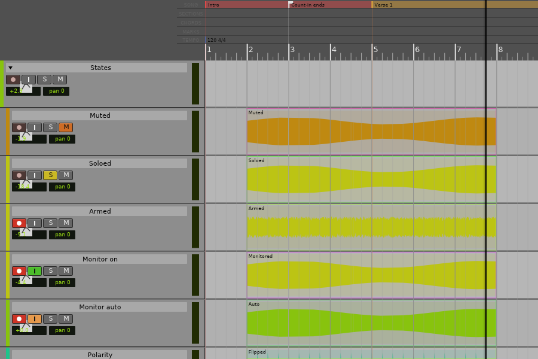](protools-classic/tcp.closeup.png) |
| **Mixer** `mixer.overview` 1600×900 | Every strip of the song with its rails: folders nested and stepped, the busses and the master with its FX, faders across their range, pans hard left, centre and right. | [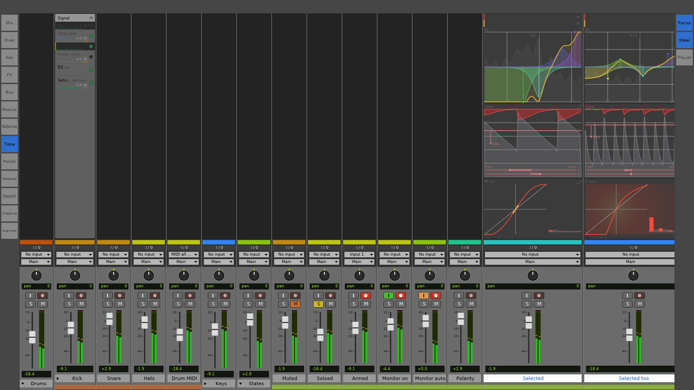](protools-classic/mixer.overview.png) |
| **Strip states** `mixer.strip-states` 1600×900 | The strips of the state tracks: muted, soloed, armed, monitoring, polarity, FX bypassed and missing, sends and receives, selected. | [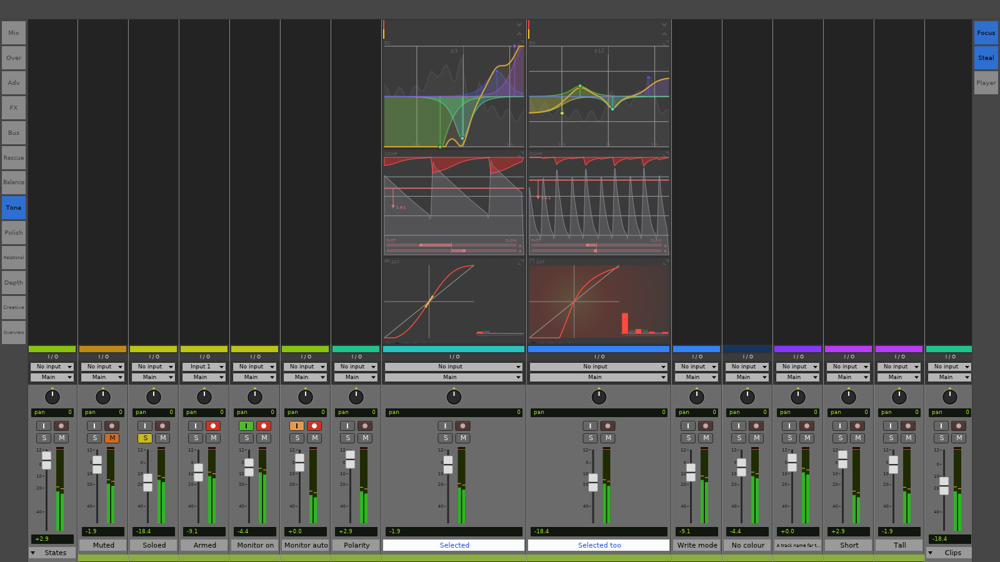](protools-classic/mixer.strip-states.png) |
| **Inserts and Signal** `mixer.inserts-signal` 1600×900 | The Tone rack's units on the kit, and a Signal FX open block by block beside one shut, with a block bypassed, one in error and one unavailable. | [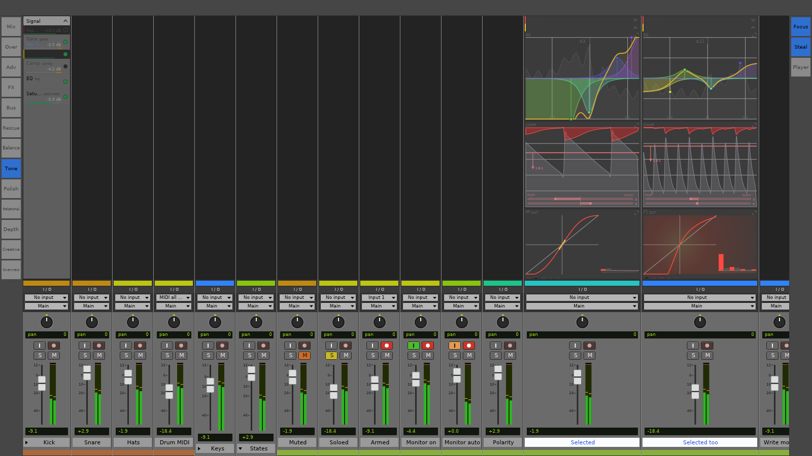](protools-classic/mixer.inserts-signal.png) |
| **Meters** `mixer.meters` 900×600 | Meters frozen at chosen levels: quiet, near 0 dB, over, clipped, with their peak holds. | [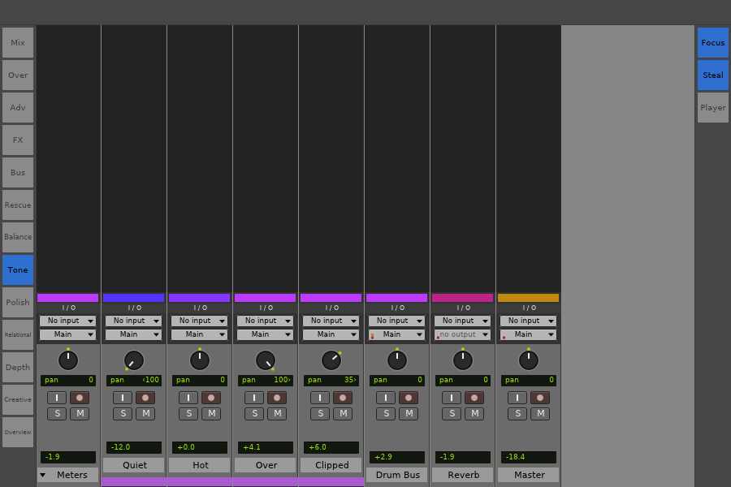](protools-classic/mixer.meters.png) |
| **FX phases** `fx.phases` 1600×900 | The FX view on the snare: each mix phase's header and its macros. | [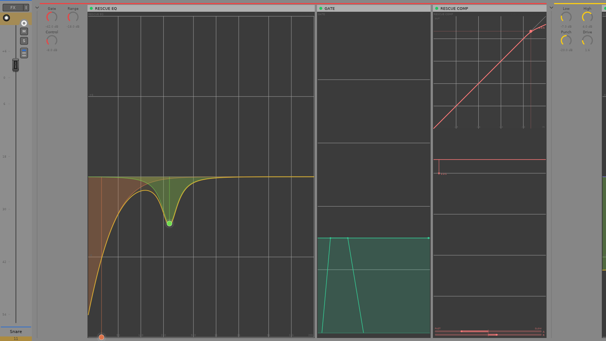](protools-classic/fx.phases.png) |
| **Drum lanes** `editor.drums` 1600×900 | The drum groove on the kit's lanes, every piece in its colour: accents and ghost notes, a flam, a tom fill, bar 2's snares selected, velocities in the strip and the song's markers on the ruler. | [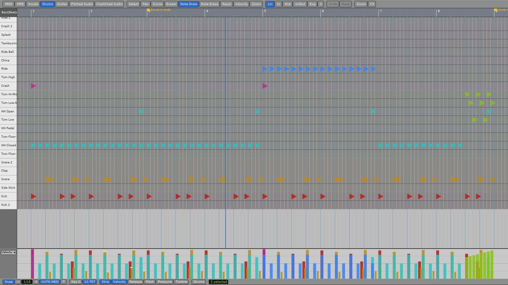](protools-classic/editor.drums.png) |
| **Piano roll** `editor.piano` 1600×900 | The melody on a piano roll: notes from C1 to C7, every pitch class in its colour, velocities from soft to hard, triplets on a triplet grid, a held chord selected, a razor area, the keyboard with a line at every C. | [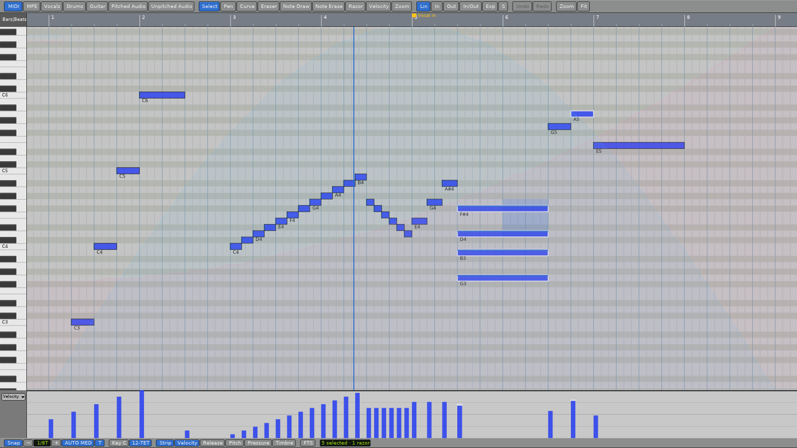](protools-classic/editor.piano.png) |
| **Controller lanes** `editor.cc` 1600×900 | The melody's controller lanes opened out: the mod wheel, expression and the sustain pedal, and the strip on velocity. | [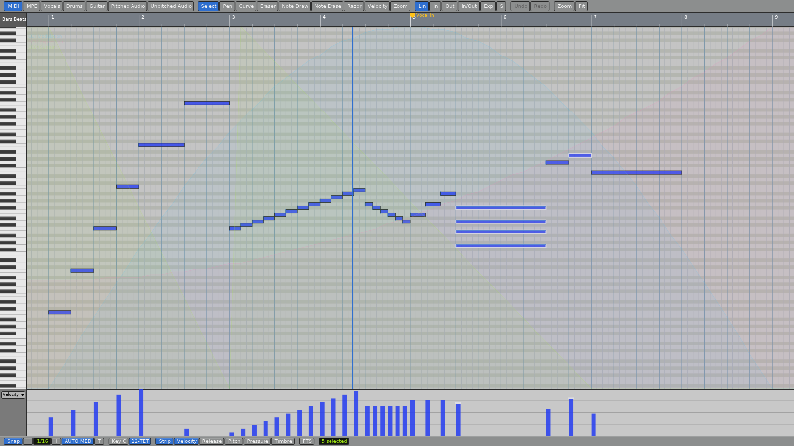](protools-classic/editor.cc.png) |
| **Sung take** `editor.vocal` 1600×900 | The editor on a sung take: its waveform behind the notes, a note selected with its drag handles, a long note cut into zones. | [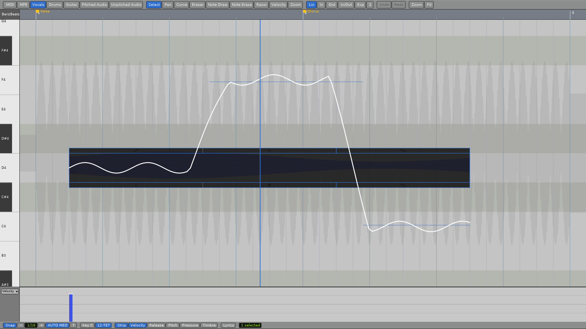](protools-classic/editor.vocal.png) |
| **Stacked lanes** `editor.stack` 1600×900 | A tracked kit in the editor's stacked lanes, mic by mic, each lane's waveform under its hits. | [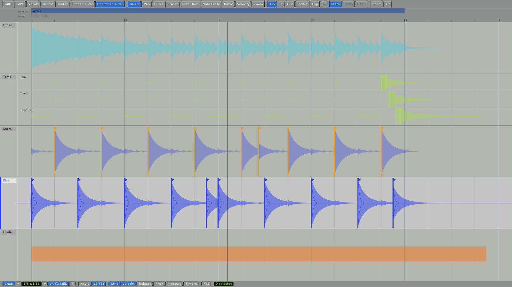](protools-classic/editor.stack.png) |
| **Editor menu** `editor.menu` 900×600 | The editor's context menu, open over the groove, the pointer on an item. | [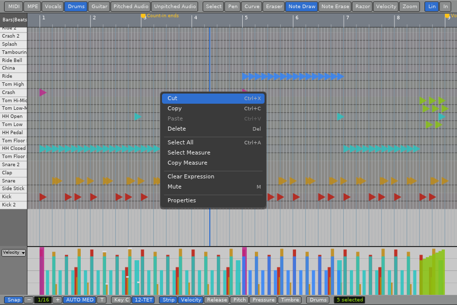](protools-classic/editor.menu.png) |
| **Live strips** `mixer.live` 1600×900 | The mixer's live (performance) strips, the short band a pack draws when it sets `strip.live`. | [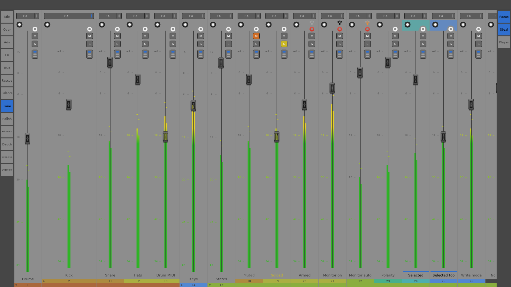](protools-classic/mixer.live.png) |
| **Arrangement, phone** `arrangement.overview.phone` 390×844 | The arrangement at a phone's width. | [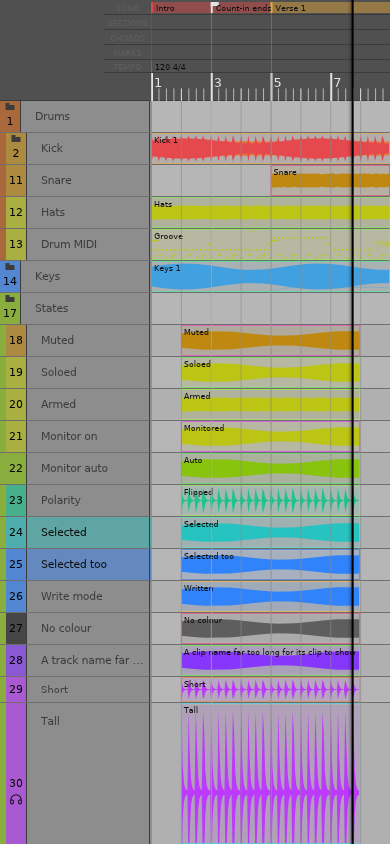](protools-classic/arrangement.overview.phone.png) |
| **Mixer, phone** `mixer.overview.phone` 390×844 | The mixer at a phone's width. | [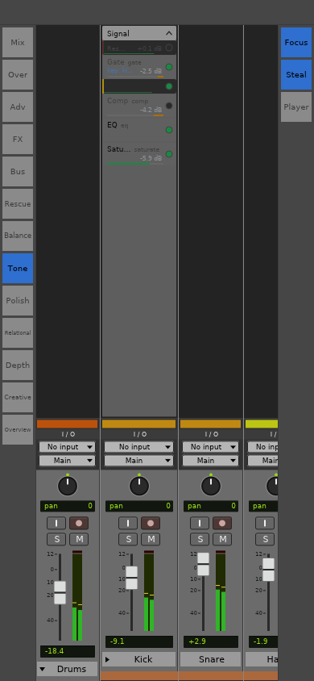](protools-classic/mixer.overview.phone.png) |
| **Drum lanes, phone** `editor.drums.phone` 390×844 | The drum lanes at a phone's width. | [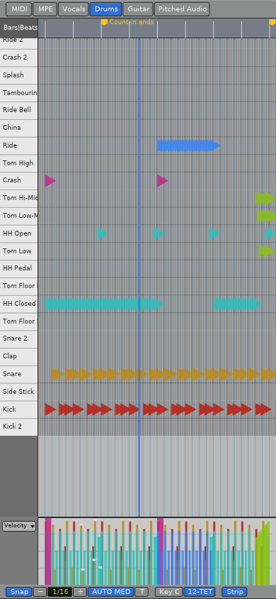](protools-classic/editor.drums.phone.png) |
| **Piano roll, phone** `editor.piano.phone` 390×844 | The piano roll at a phone's width. | [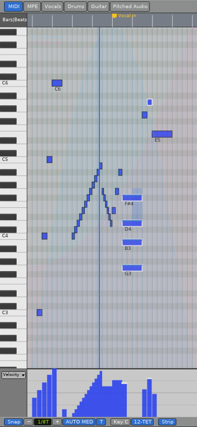](protools-classic/editor.piano.phone.png) |
| **Controller lanes, phone** `editor.cc.phone` 390×844 | The controller lanes at a phone's width. | [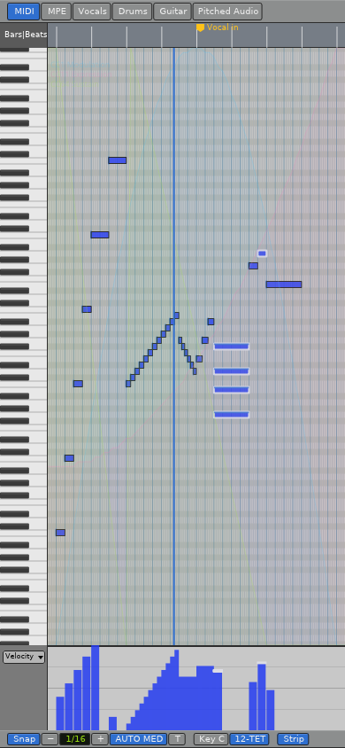](protools-classic/editor.cc.phone.png) |

## Dark (`protools-dark`)

| Shot | What it shows | Picture |
| --- | --- | --- |
| **Arrangement** `arrangement.overview` 1600×900 | The whole song: folders three deep, every clip colour, sections, markers, tempo and meter changes, the edit cursor, a time selection and the playhead. | [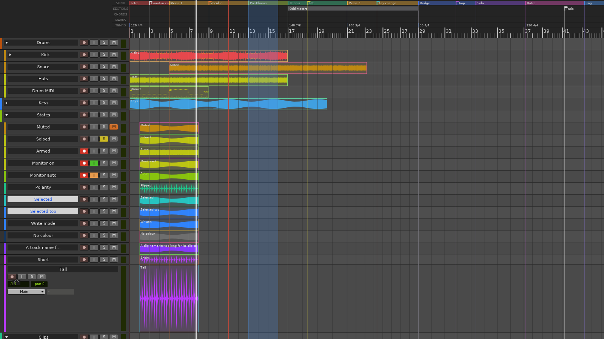](protools-dark/arrangement.overview.png) |
| **Track states** `arrangement.track-states` 1600×900 | One track per state: muted, soloed, solo-safe, armed, monitoring on and auto, polarity flipped, FX bypassed and missing, selected, several selected, a focused track, and a track with no colour. | [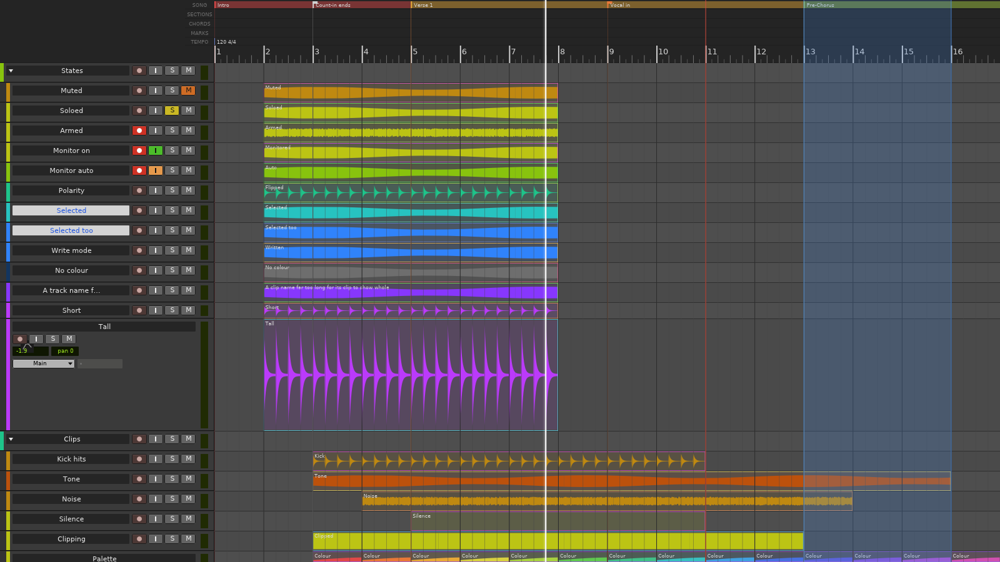](protools-dark/arrangement.track-states.png) |
| **Clips** `arrangement.clips` 1600×900 | Audio drawn from synthesized waveforms (a kick, a tone, noise, silence, a clipped bus) and MIDI notes; clips selected, muted, locked, faded, crossfaded, overlapping, on take lanes, and past both edges of the view. | [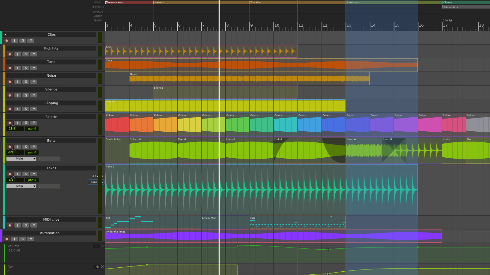](protools-dark/arrangement.clips.png) |
| **Ruler and tempo** `arrangement.ruler-tempo` 1600×900 | The ruler close up across the tempo and meter changes (4/4, 7/8, 3/4), the sections of every colour and the markers above them. | [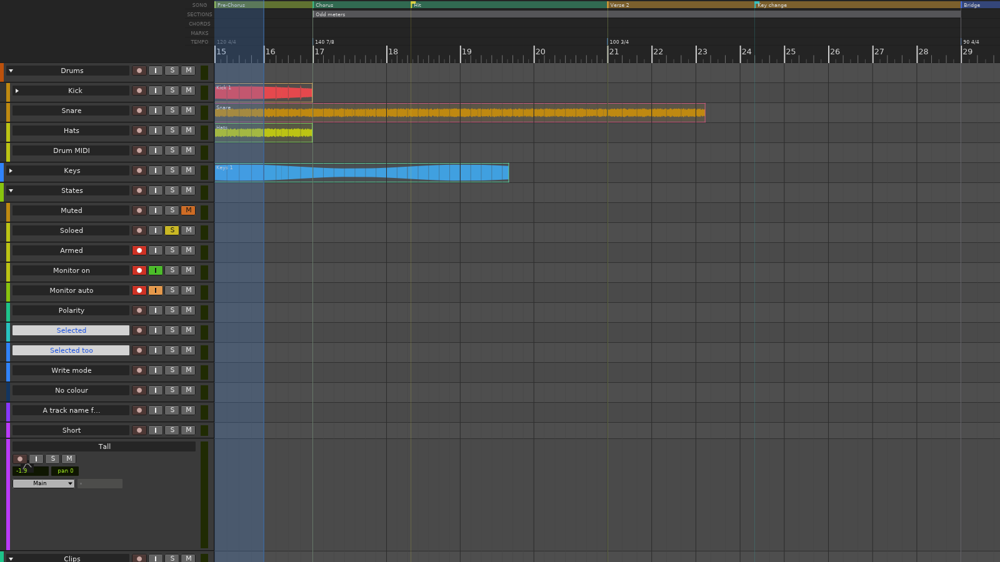](protools-dark/arrangement.ruler-tempo.png) |
| **Automation** `arrangement.automation` 1600×900 | Volume, pan, mute and a plugin parameter, each in its mode, with points of every shape. | [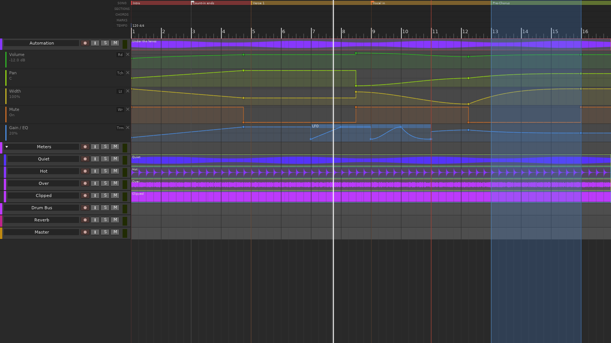](protools-dark/arrangement.automation.png) |
| **Track panel** `tcp.closeup` 900×600 | A few rows of the track panel tall enough to read every control: names, numbers, the folder buttons, the controls a row places, a long name cut short. | [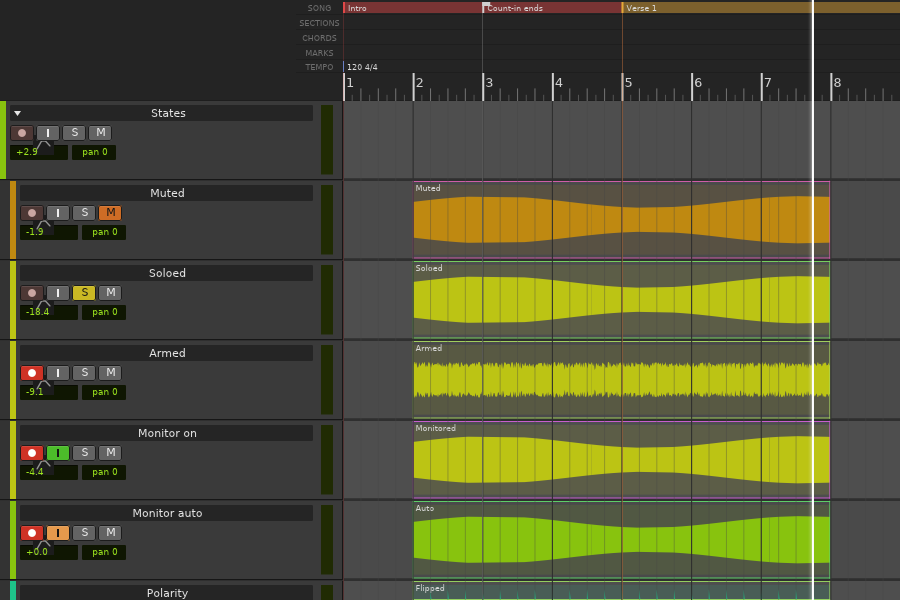](protools-dark/tcp.closeup.png) |
| **Mixer** `mixer.overview` 1600×900 | Every strip of the song with its rails: folders nested and stepped, the busses and the master with its FX, faders across their range, pans hard left, centre and right. | [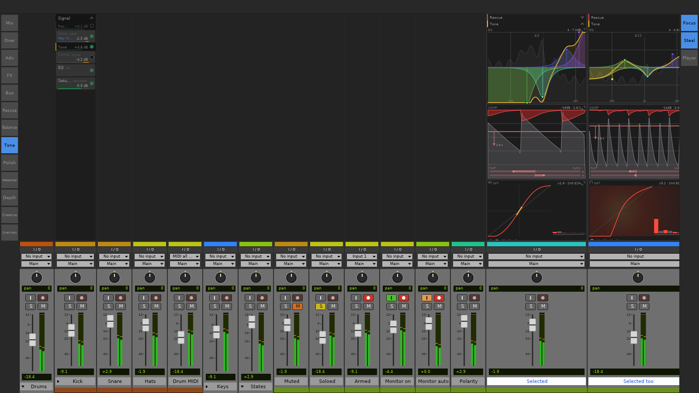](protools-dark/mixer.overview.png) |
| **Strip states** `mixer.strip-states` 1600×900 | The strips of the state tracks: muted, soloed, armed, monitoring, polarity, FX bypassed and missing, sends and receives, selected. | [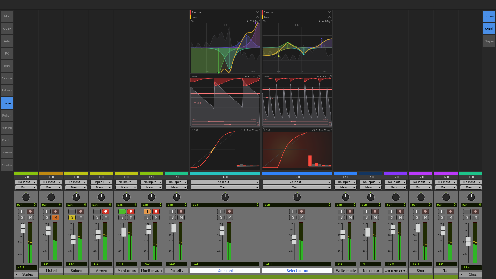](protools-dark/mixer.strip-states.png) |
| **Inserts and Signal** `mixer.inserts-signal` 1600×900 | The Tone rack's units on the kit, and a Signal FX open block by block beside one shut, with a block bypassed, one in error and one unavailable. | [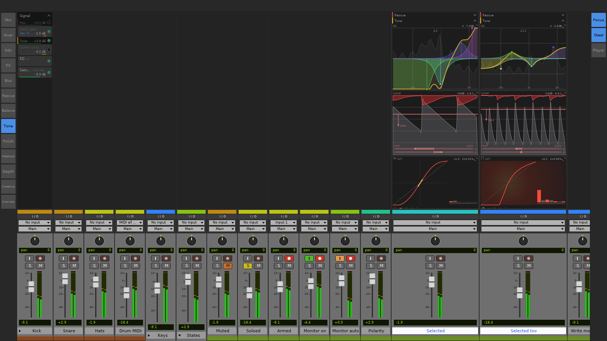](protools-dark/mixer.inserts-signal.png) |
| **Meters** `mixer.meters` 900×600 | Meters frozen at chosen levels: quiet, near 0 dB, over, clipped, with their peak holds. | [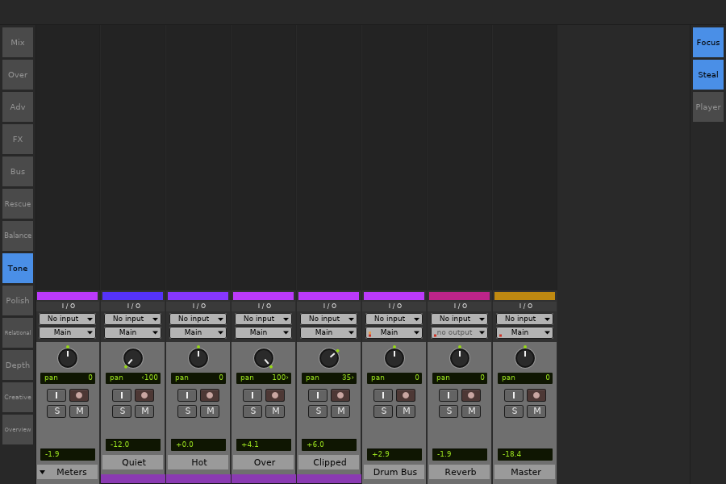](protools-dark/mixer.meters.png) |
| **FX phases** `fx.phases` 1600×900 | The FX view on the snare: each mix phase's header and its macros. | [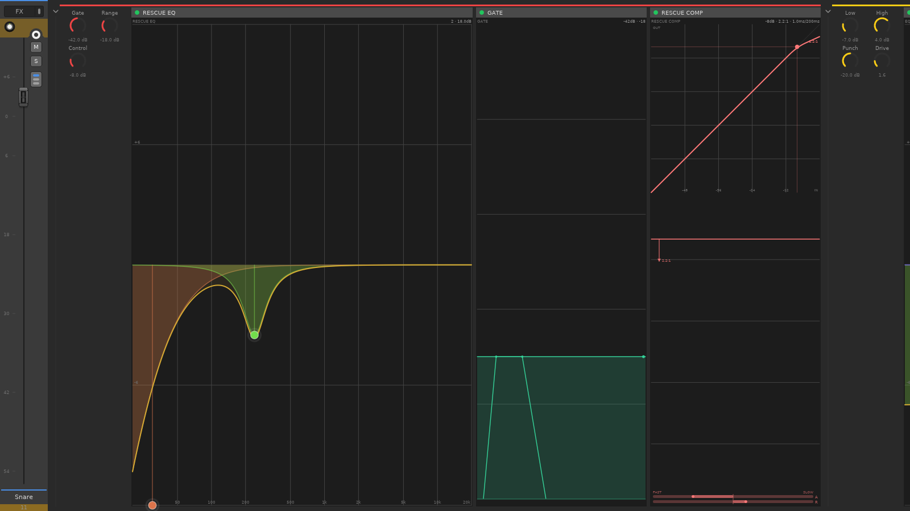](protools-dark/fx.phases.png) |
| **Drum lanes** `editor.drums` 1600×900 | The drum groove on the kit's lanes, every piece in its colour: accents and ghost notes, a flam, a tom fill, bar 2's snares selected, velocities in the strip and the song's markers on the ruler. | [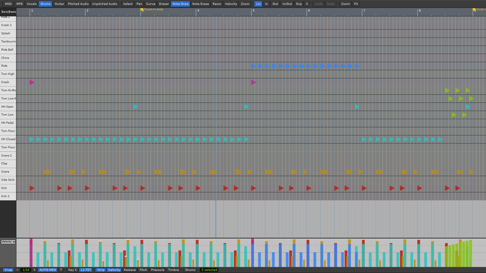](protools-dark/editor.drums.png) |
| **Piano roll** `editor.piano` 1600×900 | The melody on a piano roll: notes from C1 to C7, every pitch class in its colour, velocities from soft to hard, triplets on a triplet grid, a held chord selected, a razor area, the keyboard with a line at every C. | [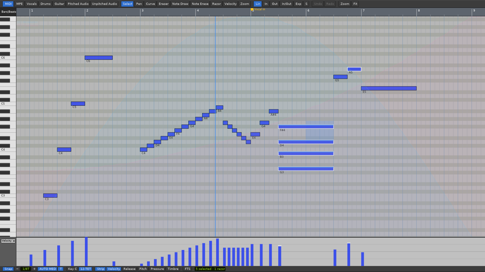](protools-dark/editor.piano.png) |
| **Controller lanes** `editor.cc` 1600×900 | The melody's controller lanes opened out: the mod wheel, expression and the sustain pedal, and the strip on velocity. | [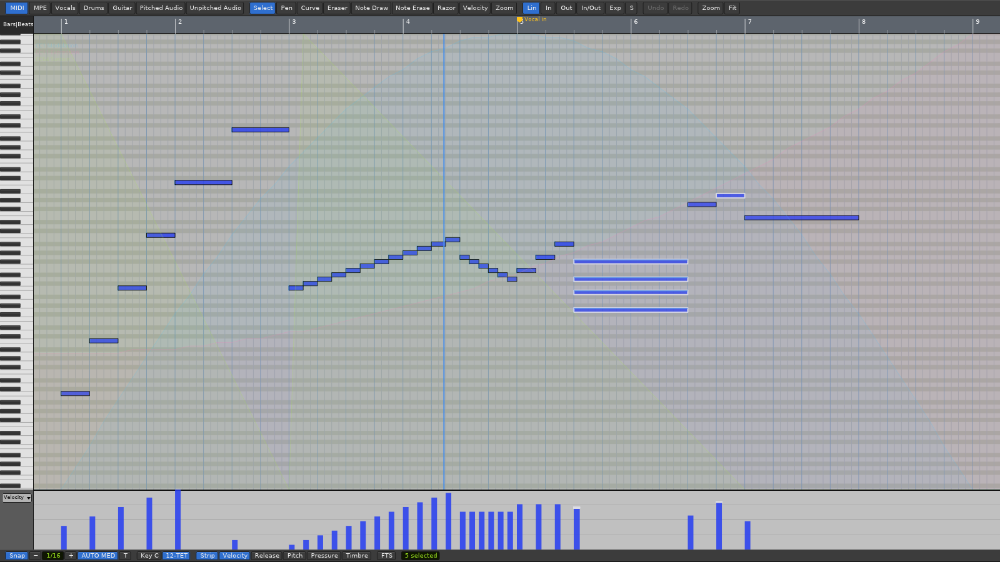](protools-dark/editor.cc.png) |
| **Sung take** `editor.vocal` 1600×900 | The editor on a sung take: its waveform behind the notes, a note selected with its drag handles, a long note cut into zones. | [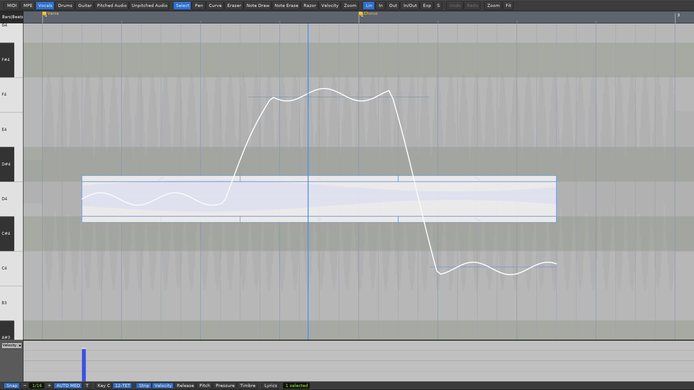](protools-dark/editor.vocal.png) |
| **Stacked lanes** `editor.stack` 1600×900 | A tracked kit in the editor's stacked lanes, mic by mic, each lane's waveform under its hits. | [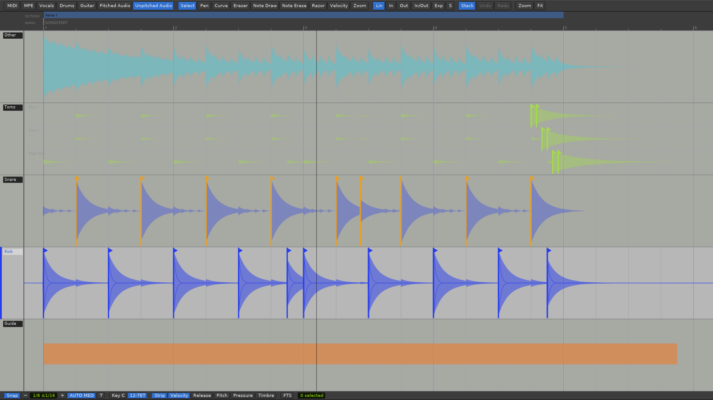](protools-dark/editor.stack.png) |
| **Editor menu** `editor.menu` 900×600 | The editor's context menu, open over the groove, the pointer on an item. | [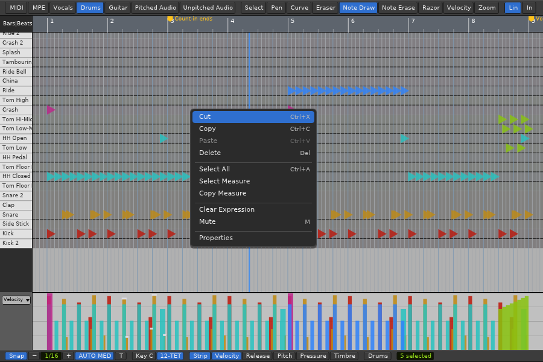](protools-dark/editor.menu.png) |
| **Live strips** `mixer.live` 1600×900 | The mixer's live (performance) strips, the short band a pack draws when it sets `strip.live`. | [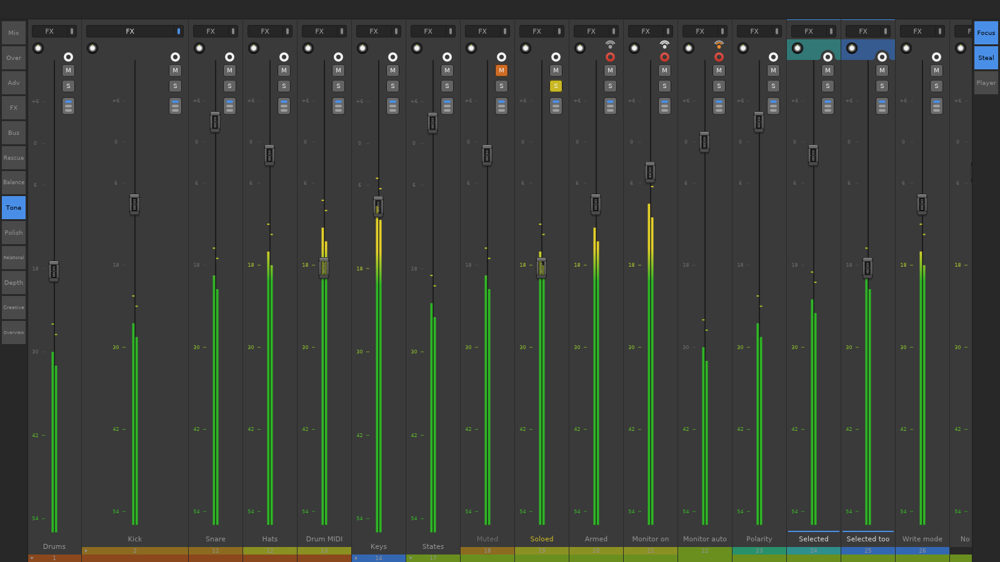](protools-dark/mixer.live.png) |
| **Arrangement, phone** `arrangement.overview.phone` 390×844 | The arrangement at a phone's width. | [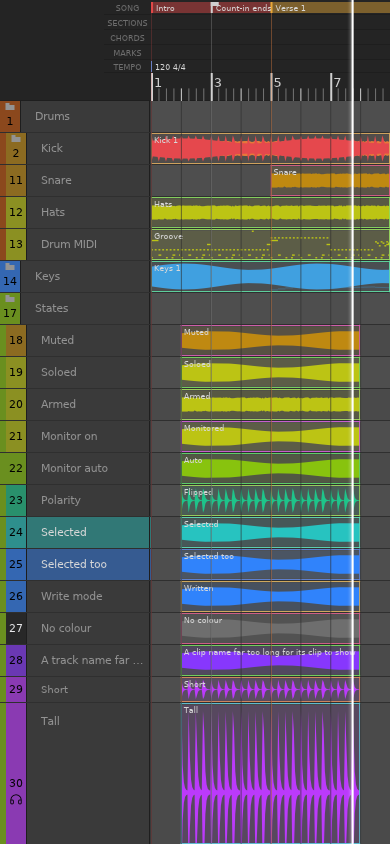](protools-dark/arrangement.overview.phone.png) |
| **Mixer, phone** `mixer.overview.phone` 390×844 | The mixer at a phone's width. | [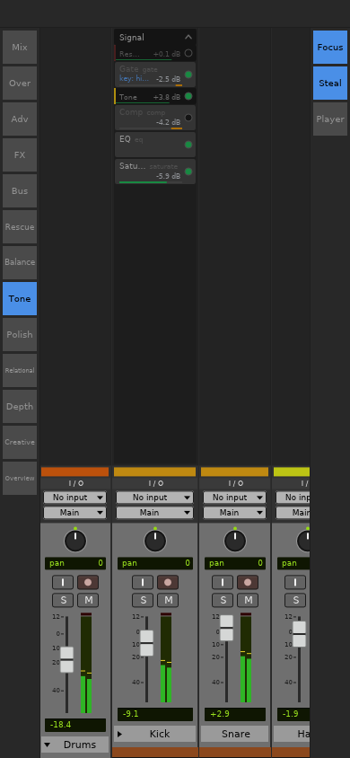](protools-dark/mixer.overview.phone.png) |
| **Drum lanes, phone** `editor.drums.phone` 390×844 | The drum lanes at a phone's width. | [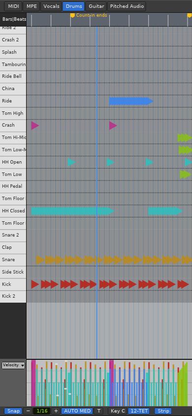](protools-dark/editor.drums.phone.png) |
| **Piano roll, phone** `editor.piano.phone` 390×844 | The piano roll at a phone's width. | [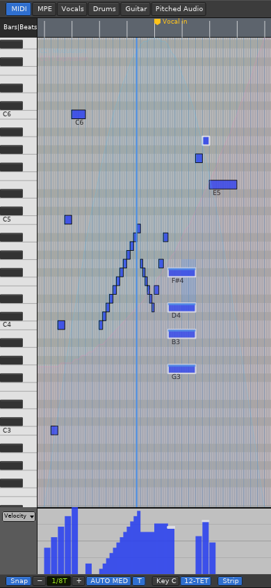](protools-dark/editor.piano.phone.png) |
| **Controller lanes, phone** `editor.cc.phone` 390×844 | The controller lanes at a phone's width. | [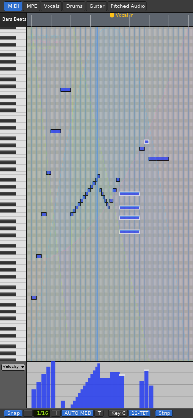](protools-dark/editor.cc.phone.png) |

